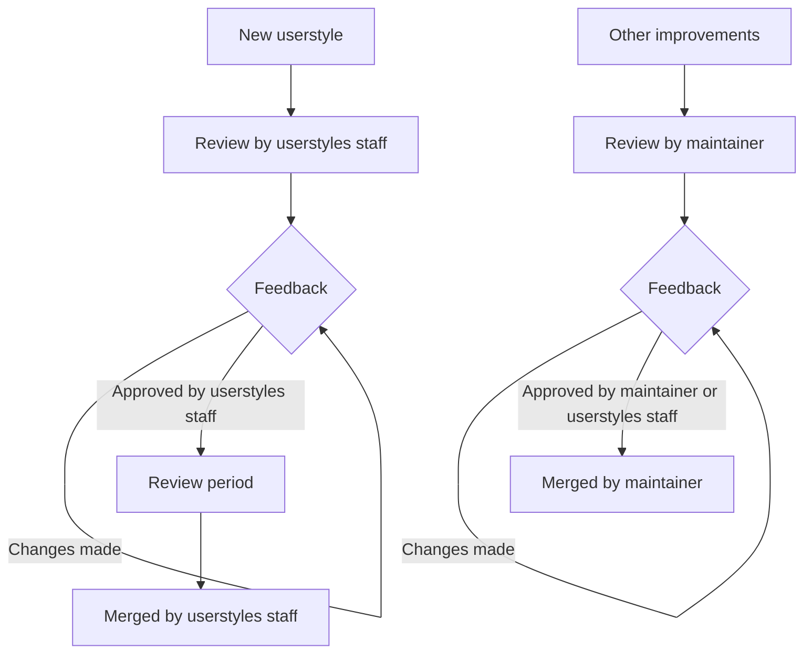

If it is your first time contributing to a project on GitHub, please see the popular [first-contributions](https://github.com/firstcontributions/first-contributions) repository. This will give you hands-on experience with the features of GitHub required to make a contribution. As always, feel free to join our [Discord](https://discord.com/servers/catppuccin-907385605422448742) to ask any questions and clarify your understanding, we are more than happy to help!

## Development environment

This repository uses [Node.js](https://nodejs.org/) and [pnpm](https://pnpm.io/) extensively for linting, formatting, and automation. It is highly recommended to set up Node.js (v24.14 or later) and pnpm locally to improve your workflow — see ["Download Node.js" - Node.js](https://nodejs.org/en/download) and ["Installation" - pnpm Docs](https://pnpm.io/installation). Then, run `pnpm install` to install the dependencies.

With Node.js and pnpm installed locally, you can lint all userstyles with `pnpm lint`, and if any issues are found, `pnpm lint:fix` to automatically apply fixes in some cases. For quicker linting, specify the userstyle to lint with `pnpm lint my-userstyle` (or equivalently using the relative path/autocomplete, `pnpm lint styles/my-userstyle`).

It's helpful to maintainers to run formatting with `pnpm fmt` before opening a pull request, though not strictly necessary.

> [!IMPORTANT]
> `pnpm lint` is not to be confused with `pnpm check`. `pnpm check` only checks our TypeScript files in `scripts/`, whereas `pnpm lint` is the custom script for linting userstyles that you should be using.

To edit and/or create userstyles, [set up live reloading](/contributing/tips-and-tricks/hot-reloading/) so that local changes (edits made from your editor of choice) can be automatically reloaded through Stylus.

## Versioning

You may notice that userstyles contain a line in the format of `@version 2000.01.01` in the UserCSS metadata section at the top. **This line should not be edited by hand**. We use an automated versioning system that updates the version value (based on [Calendar Versioning](https://calver.org/)) when a change is made to a userstyle, after merging the pull request.

## Authoring userstyles

### Assessing websites

Some websites are, unfortunately, not ideal for userstyles. Websites with auto-generated classes — think `aeN WR beA nH oy8Mbf`, `cfb2a888`, and so on — lead to unreadable and unmaintainable userstyles that break quickly and are difficult to update/maintain. Such userstyles, if created, will also take longer to review and merge.

On the other hand, if a website uses CSS variables — see below — it is a great candidate for userstyling.

### CSS variables

While writing a userstyle, you may come across [CSS variables](https://developer.mozilla.org/en-US/docs/Web/CSS/--*) (or "custom properties"). We prefer that these variables are used if present, rather than theming individual elements. As the website typically uses these variables itself, it saves a lot of work in theming and maintaining the userstyle.

### Opinionated changes

When writing or updating a userstyle, it is important to keep in mind that different users have different preferences. To avoid lengthy discussion over user interface aesthetics, we have a set of rules for what a userstyle may include; importantly, **changes to font, layout, padding, margin, display, and in general anything besides color tweaks are prohibited.**

### Pull requests

- Create a [topic branch](https://git-scm.com/book/en/v2/Git-Branching-Branching-Workflows#_topic_branch) on your fork for your specific PR.
- Catppuccin uses the [Conventional Commits](https://www.conventionalcommits.org/en/v1.0.0/) standard for creating explicit and meaningful commit messages. This repository requires pull request _titles_ to be in the conventional commit format, however we do not require it for individual commits within a pull request.
- It's better to have a draft pull request than no pull request at all. Having a draft lets others know that a userstyle is being worked on, and gives the opportunity for people to try it out ahead of time (if they really want it themed!).

### Contribution review process

